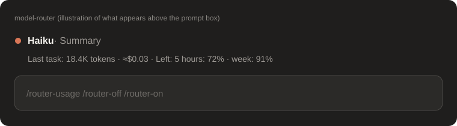
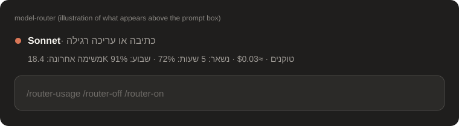

# model-router

Picks a model for each request you type, so simple tasks don't spend your Opus quota:

- Haiku: short, simple tasks (summarize, translate, rename a file, search files)
- Sonnet: regular writing and editing
- Opus: planning, complex bugs, changes across many files, and anything it is unsure about

The chosen model and a one-line reason show above the prompt (the picture below is an illustration, not a screenshot).



In Hebrew:



`/router-off` turns routing off (the session's own `/model` is used), `/router-on` turns it back on; the choice is remembered across sessions. Subagents keep their own model.

Edit the rules in `hooks/rules.ts`: each rule is a model, a list of trigger words (Hebrew or English), and the reason shown.

## Language

The band and the command replies are in English or Hebrew. By default (`auto`) they follow the language of each prompt you type; set the plugin's **Display language** option to `en` or `he` to fix one. Trigger words in `hooks/rules.ts` cover both languages.

## Token usage

A second line above the prompt shows the tokens the last task used (every model request it made, subagents included, with an estimated cost) and what is left of the 5-hour and weekly limits. `/router-usage` lists the last 15 tasks with their tokens. The limits are reported by Anthropic as a percentage, not a token count, and only on a subscription.

## Install

At the prompt of a Claude Code terminal session:

```
/plugin install model-router --marketplace moshabdesign-bit/model-router
```

Answer `y` to add the marketplace, then pick the user scope.

From a shell:

```
claude plugin install model-router --marketplace moshabdesign-bit/model-router
```

In the desktop app: click + next to the prompt box, then Plugins, Add marketplace with `moshabdesign-bit/model-router`, then Add plugin.
